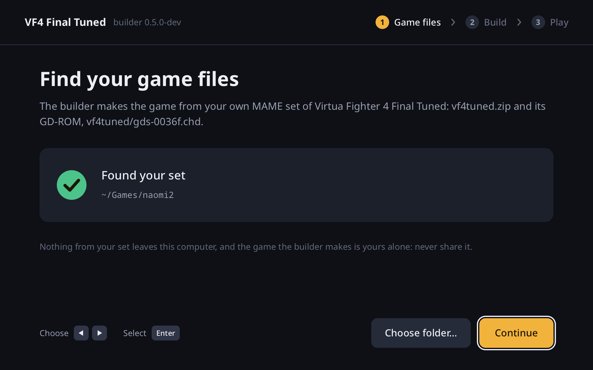
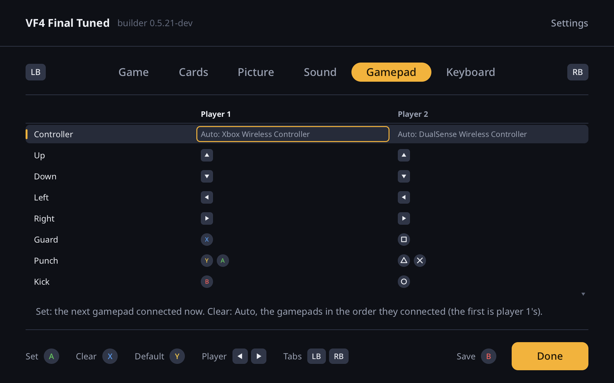
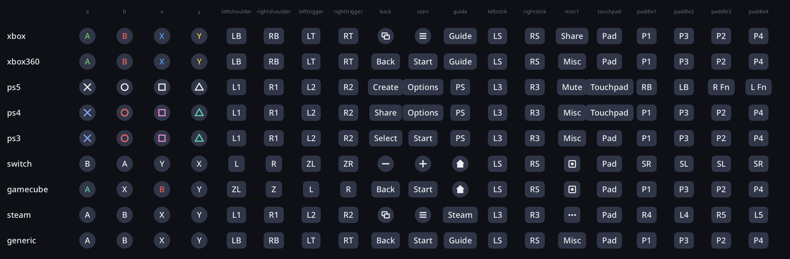
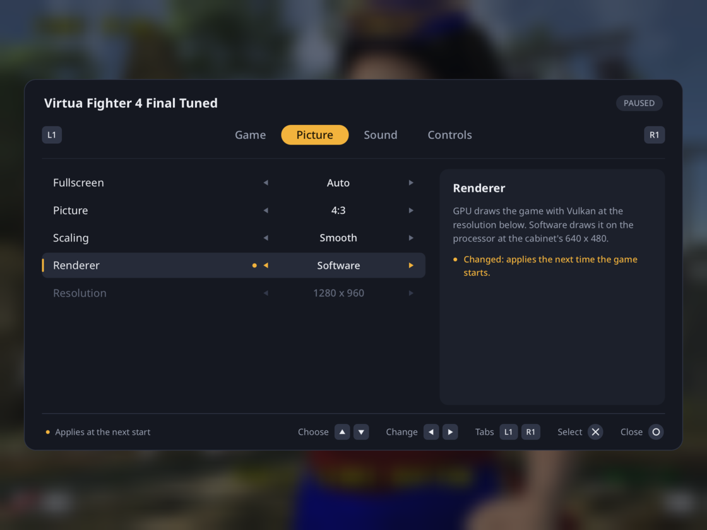

# VF4 Final Tuned (Ver. B): native recomp

[](https://ko-fi.com/P5P81EV1M0)

*Virtua Fighter 4 Final Tuned (Ver. B)* (Sega AM2, Naomi 2, 2004) as a
native Windows program, for Windows and for Steam under Proton.

The game's SH-4 program is translated to C and compiled into a Windows
executable **on your PC, from your own MAME set**. The Naomi 2 hardware is
done by the program itself, and the pictures are drawn on your GPU. No
emulator runs at play time.

> [!IMPORTANT]
> This repository **does not contain the game, its code, its data or an
> executable**. You need your own MAME `vf4tuned` set: `gds-0036f.chd` and
> `vf4tuned.zip` (the 317-0387-COM PIC). Everything the build creates comes
> from your set and stays on your PC. Never share those files.

## Installing a release

Download `vf4ft-…-windows.zip` from this repository's Releases page. It
holds the launcher and builder only, no game. You also need your MAME
`vf4tuned` set: `vf4tuned.zip` and `vf4tuned/gds-0036f.chd`.

**On Windows:**

1. Extract the zip into a folder of its own, for example `C:\Games\VF4FT`.
2. Run `vf4ft-launcher.exe`.
3. **Game files:** Use this set (one it found), or Choose folder… and pick
   the folder that holds `vf4tuned.zip`.
4. **Build:** the game goes into `game\` beside the launcher, or elsewhere
   with Change…. Press Build. The first build downloads about 200 MB of
   compiler and takes a few minutes.
5. **Play.** Optional: to have the game in your Steam library too, exit
   Steam (Steam menu, Exit), then press Add to Steam on the Play page
   (Steam rewrites its shortcuts when it exits, so it must be closed).
   Or turn on **Start the game directly** on the Play page: from then on
   the launcher opens the game straight away, and the game's menu has
   **Open the launcher**.

**On Linux or a Steam Deck**, through Steam's Proton:

1. Extract the zip into a folder of its own, for example `~/Games/vf4ft`.
2. In Steam: Games menu, "Add a Non-Steam Game to My Library", Browse, set
   the file type to "All Files", pick `vf4ft-launcher.exe` in that folder,
   "Add Selected Programs".
3. Right-click the new entry, Properties. Its name (the file's name at
   first) can be changed at the top, to Virtua Fighter 4 Final Tuned for
   example. Compatibility: tick "Force the use of a specific Steam Play
   compatibility tool" and choose Proton Experimental.
4. Start it from your Steam library, then do steps 3 and 4 above, and
   press **Play**: the game starts under the same Proton, with Steam
   Input. This entry is how you play from now on (it opens on Play once
   the game is built). The launcher does not offer Add to Steam here: it
   is in Steam already. To have the entry open the game straight away,
   turn on **Start the game directly** on the Play page; the game's menu
   then has **Open the launcher**.

On a Steam Deck, do steps 1 to 3 in Desktop Mode and step 4 in Game Mode
([more for the Deck](#steam-deck-m6)). Plain Wine is not supported.

## Screenshots

**The launcher** makes the game from your set in three steps. These are
the Linux launcher's pages; the Windows release is the same program.

| Game files | Build |
|---|---|
|  |  |
| It finds your MAME set, or you choose its folder. | About a minute. Cancel stops it and keeps the game you had. |

| Play | Settings |
|---|---|
|  |  |
| Play, add the game to Steam, or build it again. | The game's settings and controls in tabs. The defaults are the PlayStation 2 version's layout. |

**The game's menu**, over the paused game: Insert or Esc, a gamepad's Guide
button, or View + Menu held for a second. The keys and buttons at its foot
are the ones you last used, here a DualSense's. Settings that apply at the
next start keep a dot until then.

Each kind of gamepad has its own names for the buttons: Xbox One and
Series, Xbox 360, DualSense, DualShock 4 and 3, Switch, GameCube, the
Steam Deck and Steam Controller, and any other pad. In the menus a button
does what its label says (A or ✕ selects, B or ○ goes back, wherever a
Nintendo pad has them); the game's controls go by where the buttons sit.





| Game (keyboard) | Controls (DualSense) |
|---|---|
|  |  |

## Status

Playable with sound, built on your PC from your own set by the builder
(M5): from the command line or with the launcher. M6 added saves, free
play, the card units, a settings page with rebinding, the GPU renderer at
up to 4 times the resolution, the Steam Deck route, and the operator's
test mode. The game has its own menu over the picture (Insert, Esc, a
gamepad's Guide button, or View + Menu held): it pauses the game, changes
settings, reaches test mode from a gamepad, restarts and quits. The latest
release, 0.5.1 (Windows, and the Steam Deck through Proton), is on the
Releases page. The plan, with its
milestones: [docs/design.md](docs/design.md).

| Milestone | State |
|---|---|
| M0: cross build, window, input, Steam/Proton | Done 2026-11-12. `vf4ft.exe` runs under Proton Experimental from Steam (Direct3D 12 through vkd3d-proton by default, Vulkan too) and natively on Linux; with Steam Input on it sees exactly one controller (Steam's virtual pad) and reads stick, D-pad and buttons |
| M1: translator | Done 2026-11-12. Both programs translate to C (6,632 + 2,120 routines) that compiles with no warnings for Windows and Linux; 1.8 million checks against VF4debug's interpreter, none failed ([details](docs/design.md#12-m1-results-2026-11-12)) |
| M2: runtime with the hardware models, headless | Done 2026-11-12. The translated game boots to attract and plays CPU vs CPU matches on VF4debug's hardware models, instruction for instruction the same run as VF4debug's (36,000 attract frames and two whole matches compared hash for hash); about 4 times the real hardware's speed with no picture yet ([details](docs/design.md#13-m2-results-2026-11-12)) |
| M3: picture, input, real time | Done 2026-11-12. The game runs in a window at 60 fps natively on Linux and under Proton (Direct3D 12), with keyboard and gamepads, and gives the same run as VF4debug's; played through coin, start and a match with a DualSense. The picture is VF4debug's software renderer, 8 to 9 ms a frame with the machine while playing ([details](docs/design.md#15-m3-results-2026-11-12)) |
| M4: sound | Done 2026-11-12. The game's own sound driver runs on an ARM7 interpreter with a model of the AICA chip and its effect DSP: music, voices, effects and the game's reverb play in the window on Linux and under Proton, and every run is deterministic ([details](docs/design.md#17-m4-results-2026-11-12), [the DSP](docs/design.md#18-the-effect-dsp-2026-11-12)) |
| M5: builder and launcher | Done 2026-11-12. Your MAME set to an installed game in about a minute, with no MAME tools and nothing to install: the builder reads the CHD itself, keeps the disc's encrypted image (the game decrypts it at start), downloads a pinned compiler and SDL3, translates and compiles. The Windows launcher (with its own Python) built and played the game under Proton in a fresh prefix ([details](docs/design.md#19-m5-results-2026-11-12)) |
| M6: polish | Done 2026-11-12. Saves (the cabinet's backup RAM and settings EEPROM), free play by default the operator's way (or arcade coins), the two card units, `user/settings.txt` with the launcher's Settings page and rebinding. The GPU renderer (Vulkan, natively and under Proton) draws at 1 to 4 times 640 x 480 and matches the software picture; the machine's frame went from 7.0 to 3.1 ms, which puts the Steam Deck at an estimated 10 to 12 ms a frame. The Deck runs the Windows release under Proton (not yet tried on a real Deck). Test mode runs the game's own test program, `test.bin`, and EXIT starts the game again ([details](docs/design.md#20-m6-results-2026-11-12)) |

## How it works

1. The builder reads your MAME set (its own CHD reader: no MAME tools),
   checks it is the supported version, and takes out the DIMM image and its
   key; it decrypts the program it translates.
2. The translator turns every one of the game's 6,632 routines into C. It
   uses the routine tables of the matching decompilation
   ([VF4-Final-Tuned-Rev-B-Decomp-Source](https://github.com/djanice1980/VF4-Final-Tuned-Rev-B-Decomp-Source)).
3. clang (llvm-mingw) compiles that C together with the runtime, which takes
   the place of the Naomi 2 hardware: inputs, the DIMM board, the ELAN and
   rendering chips (drawn with SDL_GPU), and the AICA sound chip.
4. You play the resulting `vf4ft.exe` on Windows, or add it to Steam as a
   non-Steam game and run it with Proton.

## Building the game from your set (M5)

You need your MAME `vf4tuned` set in one folder: `gds-0036f.chd` and
`vf4tuned.zip` side by side, or MAME's own layout (`roms/vf4tuned.zip` and
`roms/vf4tuned/gds-0036f.chd`; then give the `roms` folder). The builder
checks both files and stops with a message if either is not the right one.
It downloads the pinned compiler (llvm-mingw, 84 MB on Linux, 191 MB on
Windows) and SDL3 on its first run, into `~/.cache/vf4ft-builder` (Linux)
or `%LOCALAPPDATA%\vf4ft-builder` (Windows), and checks their SHA-256. A
build takes about a minute on a fast PC.

**From this repository on Linux** (Python 3.12 or later: `python3
--version`; Arch: `sudo pacman -S python`). Replace the two folders with
yours:

```bash
python3 -I tools/make_game.py --set ~/Games/naomi2 --out ~/Games/vf4ft
```

That makes `~/Games/vf4ft/vf4ft.exe` (with `SDL3.dll`, `data/` and `user/`).
To play it from Steam with Proton, close Steam (Steam menu, Exit), then:

```bash
python3 -I tools/steam_shortcut.py add ~/Games/vf4ft/vf4ft.exe
```

Start Steam and play "Virtua Fighter 4 Final Tuned" from the library. For
a native Linux program instead (needs clang and SDL3: `sudo pacman -S clang
sdl3 pkgconf`), add `--target linux` to the first command; that makes
`~/Games/vf4ft/vf4ft`, which you run directly.

After updating this repository (`git pull`), rebuild the install with the
new code. The set is not needed again, and `user/` is kept:

```bash
python3 -I tools/make_game.py --update ~/Games/vf4ft
```

**With the launcher.** A release is a zip with `vf4ft-launcher` and
everything it runs (on Windows also SDL3.dll and Python's embeddable
package, so nothing has to be installed). It walks through three steps,
shown at its top: Game files (choose the set's folder; a set it finds in
the usual places is offered with Use this set, never taken by itself),
Build (where the game goes, with Change…; then the stage, a progress bar,
the time so far and the builder's last lines; Cancel stops it cleanly),
and Play. The Play page
also has Settings (the game's settings and controls, in tabs), Add to Steam
(adds the game as a non-Steam game; close Steam first; not offered when
Steam started the launcher, or under Wine or Proton), Build again, an
Update card when the builder is newer than the game it built, and **Start
the game directly**: with it on, the launcher starts hidden, opens the
game and closes with it, so its Steam entry plays the game; it still shows
itself when it is needed (nothing built, an update, an error), and the
game's menu has **Open the launcher** ([details](docs/design.md#29-start-the-game-directly-2026-11-13)). The mouse,
the keyboard (arrows, Enter, Esc; Q and E switch tabs) and a gamepad
(D-pad, A, B; LB and RB switch tabs) all work it. The game goes into
`game/` beside the launcher unless you choose another folder with Change…
on the Build page: an empty folder or an earlier install is used as it is,
and any other folder gets a `VF4 Final Tuned` folder of its own inside it
(the builder never writes among other files). Changing it copies your
saves and settings into the new folder at the next build; the old folder
stays as it was. The Windows release runs on Windows and, on Linux and
the Steam Deck, under Proton (Steam, or `umu-run`); plain Wine is not
supported ([why](docs/design.md#27-install-folder-set-choice-and-plain-wine-2026-11-13)). To build the launcher from this
repository: `cmake --build build/linux --target vf4ft-launcher` (it needs no
translated code), then `build/linux/vf4ft-launcher`. A release folder is put
together by `tools/package_release.py` (its usage is at its top).

**Updates.** A release checks this repository's Releases page each time
the launcher starts (one request to GitHub, no download). When a newer
release is out, the Play page says so:

- **Update now** downloads it, puts it in place, restarts the launcher and
  builds the game again.
- **When I close** downloads it now and puts it in when you close the
  launcher; the next start builds the game again.

Saves and settings stay. **Check for updates**, at the foot of the Play
page, asks again. A development build never updates itself; only a
release folder does (it has `release.json`). The game added with Add to
Steam starts without the launcher, so its own menu has **Check for
updates** too (Game tab). When a newer release is out, turn on **Update
when I quit**: quitting the game then starts the launcher, which updates,
builds the game again and closes ([details](docs/design.md#24-updates-2026-11-13),
[from the game](docs/design.md#25-updates-from-the-games-menu-2026-11-13)).

Release 0.5.0 has no updater. To leave it, extract the new zip, copy
everything inside its folder into your 0.5.0 folder, replacing the files,
then start the launcher and press Update on its "new builder" card. Your
Steam entry, saves and settings stay.

Whatever the builder makes is made from your copy of the game: never share
the install folder.

## Steam Deck (M6)

The Deck runs the Windows release under Proton, in Game Mode. This has not
been tried on a real Deck yet; the same release was built and played under
Proton on a desktop PC.

1. **A release zip.** Download the latest `vf4ft-…-windows.zip` from this
   repository's Releases page (about 15 MB; it holds no game data). Or make
   one on a Linux PC from this repository: steps 1 to 3 of "Development
   build" below (step 3 makes `build/win64/vf4ft-launcher.exe`), then

   ```bash
   python3 -I tools/package_release.py windows build/win64/vf4ft-launcher.exe ~/vf4ft-release
   ```

   That makes `~/vf4ft-release.zip`.
2. **On the Deck, in Desktop Mode** (Steam button, Power, Switch to Desktop):
   copy the zip over (USB stick, SD card or a network share), right-click
   it in Dolphin, Extract, Extract archive here. Put the folder anywhere,
   for example `~/Games/vf4ft-release`.
3. **Your set** (`gds-0036f.chd` and `vf4tuned.zip`): the launcher looks
   for it in EmuDeck's ROM folders (`Emulation/roms/arcade`, `naomi2`,
   `naomi` or `mame`, on the Deck or the SD card), or in `~/Games`,
   `~/Games/naomi2`, `~/roms`, `~/Downloads` or `~/Desktop`, and offers
   what it finds: Use this set. Anywhere else, pick it with Choose
   folder… on the Game files page.
4. **Add it to Steam:** open Steam on the desktop, Games menu, "Add a
   Non-Steam Game to My Library", Browse, set the file type to "All Files",
   pick `vf4ft-launcher.exe` in the release folder, then "Add Selected
   Programs". Right-click the new entry, Properties: rename it at the top
   if you like (Virtua Fighter 4 Final Tuned, say); Compatibility, tick
   "Force the use of a specific Steam Play compatibility tool" and choose
   Proton Experimental.
5. **In Game Mode**, start it from the library (the Non-Steam tab). The
   D-pad and A work the buttons (B goes back, LB and RB switch tabs):
   Use this set (or Continue), Build (the first run downloads about 190
   MB of compiler, and takes several minutes on the Deck), then Play. The
   game runs fullscreen in the same Proton prefix and the launcher comes
   back when it ends. Settings is where controls, the coin setting, the
   resolution and the rest are changed.

On the Deck's controls the game's defaults are the PlayStation 2 versions'
layout: X guard, Y and A punch, B kick, L1 throw (P+G), R1 P+K, L2 P+K+G,
R2 K+G, Menu start, View coin (not needed with free play). Holding View + Menu for a second opens the game's menu (below,
"Playing"): settings, the operator's test mode, restart and quit. The Steam
button stays Steam's.

## Development build (CachyOS / Arch)

Steps 1 to 6 build the toolchain and the window. The game itself needs the
translated code (M1, "Translating the game") and the decompilation's files:
"Playing (development, M3 to M6)" below. Until the code is translated, only the
CPU runtime is built and there is no `vf4ft` program.

1. Tools. Each prints a version line:

   ```bash
   pacman -Q cmake ninja curl sdl3
   ```

   If any is missing:

   ```bash
   sudo pacman -S --needed cmake ninja curl sdl3
   ```

2. The Windows cross toolchain (llvm-mingw 20261104) and SDL3 3.4.20 built
   with it, into `toolchain/` (about 400 MB, SHA-256 checked):

   ```bash
   tools/fetch_toolchain.sh
   ```

3. Build the Windows program (`build/win64/vf4ft.exe` + `SDL3.dll`):

   ```bash
   cmake -S . -B build/win64 -G Ninja -DCMAKE_TOOLCHAIN_FILE=cmake/llvm-mingw-x86_64.cmake -DCMAKE_BUILD_TYPE=Release && cmake --build build/win64
   ```

4. Build the native Linux program (`build/linux/vf4ft`):

   ```bash
   cmake -S . -B build/linux -G Ninja -DCMAKE_BUILD_TYPE=Release && cmake --build build/linux
   ```

5. Run the Windows program under Proton without Steam. This needs
   `umu-launcher` (`sudo pacman -S umu-launcher`) and Steam's "Proton -
   Experimental" installed (Steam: Library, search "Proton Experimental",
   Install). The prefix is kept in `build/proton-prefix`:

   ```bash
   cd build/win64 && WINEPREFIX="$PWD/../proton-prefix" GAMEID=umu-default PROTONPATH="$HOME/.steam/steam/steamapps/common/Proton - Experimental" umu-run ./vf4ft.exe
   ```

   Then read `build/win64/vf4ft.log`. Controls and options: "Playing
   (development, M3 to M6)" below.

6. Run it from Steam (Steam Input). Close Steam first (Steam menu, Exit),
   then add the program as a non-Steam game set to Proton Experimental:

   ```bash
   python3 -I tools/steam_shortcut.py add build/win64/vf4ft.exe --name "VF4 Final Tuned (recomp test)"
   ```

   It backs up `shortcuts.vdf` and `config.vdf` beside themselves
   (`*.vf4ft-backup-<time>`) and changes nothing if it cannot read them
   exactly. `python3 -I tools/steam_shortcut.py list` shows the non-Steam
   games. Start Steam, launch the entry, and check `build/win64/vf4ft.log`:
   with Steam Input on, the pad reads "Steam virtual" (vendor 28de). Under
   Proton the real pad behind it is seen too, and a line says it is left
   out ([design.md s30](docs/design.md#30-steam-inputs-twin-pads-2026-11-13)).

## Translating the game (development, M1)

The translator reads the two decrypted programs (`main.bin`, `test.bin`).
In development they come from a
[decompilation](https://github.com/djanice1980/VF4-Final-Tuned-Rev-B-Decomp-Source)
checkout beside this one (`../vf4ft-decomp/work/`, made there from the MAME
set by its `tools/extract.sh`). Its output goes to `work/gen/`, which is
made from your copy of the game: never commit or share it.

1. Translate both programs (Python 3, no packages). Each run prints a
   summary and writes `work/gen/<program>/report.txt`:

   ```bash
   python3 -I translator/translate.py --program main --image ../vf4ft-decomp/work/main.bin --out work/gen/main
   ```

   ```bash
   python3 -I translator/translate.py --program test --image ../vf4ft-decomp/work/test.bin --out work/gen/test
   ```

2. Build as in steps 3 and 4 above: CMake picks up `work/gen/` and compiles
   it into `vf4ft_gen_main` and `vf4ft_gen_test` (warnings are errors).

3. The lockstep tests against VF4debug's interpreter. They need the
   [VF4debug](https://github.com/djanice1980/VF4debug) checkout at
   `../VF4debug` and gcc with 32-bit support; check with:

   ```bash
   pacman -Q gcc lib32-glibc lib32-gcc-libs
   ```

   If any is missing (multilib must be enabled in `/etc/pacman.conf`):

   ```bash
   sudo pacman -S --needed gcc lib32-glibc lib32-gcc-libs
   ```

   Then build and run (about 3 minutes; the last line is the verdict):

   ```bash
   make -C tests/lockstep -j16 test
   ```

## Playing (development, M3 to M6)

`build/linux/vf4ft` and `build/win64/vf4ft.exe` (steps 3 and 4, once
`work/gen/` exists) are the game in a window. Each reads `data/main.bin`
and `data/vf41_s.dec` beside itself, which the build makes as links to
`../vf4ft-decomp/work/` (or `-DVF4_DECOMP=<path>`). (An install made by the
builder has the disc's `data/VF41_S.BIN` and `data/dimm.key` instead; the
game prefers those when they are there.) Linux:

```bash
build/linux/vf4ft
```

Windows under Proton: step 5 above; from Steam: step 6. The start-up
before the warning screen (about 97 s of nothing on the real board) runs
as fast as it can, so the warning screen shows after 2 to 3 seconds. The
game runs at 60 frames a second from then on. It is Japanese settings with
free play: press Start.

The default controls (all of them can be changed, below). The gamepad's
are the PlayStation 2 versions' (VF4 and VF4 Evolution, from their manuals:
square guard, triangle and cross punch, circle kick; Evolution's TYPE A
puts P+G, P+K, P+K+G and K+G on L1, R1, L2 and R2), by position on any pad:

| | Keyboard (player 1) | Gamepad (first: player 1, second: player 2) |
|---|---|---|
| Move | arrows or WASD | left stick or D-pad |
| Guard / Punch / Kick | J / K / L | X (square) / Y (triangle) and A (cross) / B (circle) |
| Punch + Guard (throw) | U | LB (L1) |
| Punch + Kick / Punch + Kick + Guard | I / O | RB (R1) / LT (L2) |
| Kick + Guard | P | RT (R2) |
| Start | Enter | Menu |
| Coin | 5 (slot 1), 6 (slot 2) | View |
| Test / Service (the operator's) | F2 / F3 | A / X on the operator bar (the menu's Operator test menu) |
| Fullscreen | F11 or Alt+Enter | |
| The game's menu (pause, settings, test mode, restart, quit) | Insert or Esc | Guide (the Xbox, PS, Home or Steam button), or hold View + Menu for a second |

Each pad is one player, also through Steam Input: under Proton the game
sees both Steam's pad and the real pad behind it, and leaves the real one
out, so one press is never player 1's and player 2's at once ([design.md
s30](docs/design.md#30-steam-inputs-twin-pads-2026-11-13)). The buttons
shown are the real pad's (a DualSense's shapes, not Xbox letters).

**The game's menu** pauses the game until it closes, over a blurred copy of
the picture. Its tabs are Game, Picture, Sound and Controls: Q and E (or
LB and RB) switch them. Up and Down choose, Left and Right change, A or
Enter selects, B or Esc goes back (A and B by their labels, so on a Switch
pad A is the right button). The mouse works too: the row under it is
chosen, a click selects it (or changes an option onward), a right click
changes an option back (elsewhere it closes the menu), the wheel moves
through the rows, and the tabs, the Q and E caps, the Ko-fi badge and the
first start's notice buttons can be clicked. The keys or buttons for each are shown
at its foot, as the keyboard or the gamepad last used names them, and the
panel on the right says what the chosen row does. Picture,
scaling, fullscreen and volume change at once; renderer, resolution and
the card units are kept for the next start (marked with a dot until then),
and credits (free play or arcade coins) apply at the next restart. Operator
test menu presses the cabinet's Test switch and shows the operator bar,
where A is Test and X is Service until B or the test menu's EXIT. Restart
the game turns the cabinet off and on (records, settings and cards are
kept); it and Quit ask for a second A. Changes are saved to
`settings.txt` when the menu closes. The Controls tab shows the controls;
they are changed in the launcher's Settings, not here.

**Test mode,** the operator's: Test (F2) opens the game's test menu (its
own test program, `test.bin`, as the cabinet's BIOS starts it). Service
(F3) moves down the menu and Test chooses; screens such as the input test
end with Service and Test together. EXIT starts the game again, from power
on, keeping what the cabinet keeps: the game assignments and book keeping
(`backup.bin`) and the cards. Free play and coins are not in the game's
test menu (they are the BIOS's): they are the `coins` setting below. Test
and Service can be moved to other keys or pad buttons like any control;
with only a gamepad, the menu's Operator test menu does the same.

**The player's folder,** `user/` beside the program (or `--user DIR`):

- `settings.txt`: what the launcher's Settings page writes, and the game
  reads when it starts. One "name = value" a line: `coins` (free play |
  arcade), `fullscreen` (auto | on | off; auto is on for the Steam Deck and
  Big Picture), `picture` (4:3 | stretch), `filter` (smooth | sharp),
  `renderer` (gpu | software), `scale` (1 to 4 times 640 x 480; default 2),
  `sound` (on | off), `volume` (0 to 100; default 100), `cards` (on |
  off), then the controls: `key1.punch =
  K` (`key1.test`, `key1.service` the operator's switches), `key2.*` for
  keyboard player 2, `pad.*` for gamepads, with SDL's key
  and button names, several separated by commas, `-` for none. The file
  the launcher writes lists every name with its choices. A line the game
  does not know is skipped, with a message in `vf4ft.log`.
- `backup.bin`: the cabinet's battery-backed RAM and settings EEPROM,
  everything the board keeps with the power off, written every 10 seconds
  when it has changed and when the game ends.
- `cards/p1.card` and `p2.card`: the two card units' cards, made the first
  time a player saves to a card.

**The GPU renderer** (`renderer = gpu`, the default) needs Vulkan: it is
used natively, and under Proton through Proton's own Vulkan. Without
Vulkan, or with `--gpu direct3d12`, the game shows the software picture
at 640 x 480, as in M3. `vf4ft.log` says which renderer it used.

Options: `--fullscreen`, `--gpu direct3d12|vulkan`, `--frames N` (quit
after N vertical blanks), `--unpaced` (no waiting, for measuring),
`--real-boot` (the start-up at its real pace too), `--image FILE`,
`--dimm FILE` (a decrypted image, or the disc's `VF41_S.BIN` with
`dimm.key` beside it), `--log FILE`, `--silent` (no sound chip: VF4debug's
mailbox model, as in M3), `--user DIR`, and for tests `--press LIST`
(buttons at given vertical blanks, as `6500:p1:start,6800:p1:p+g`),
`--shot N FILE` (the picture at vertical blank N to a BMP file) and
`--keys LIST` (keys and virtual gamepad buttons one after another from a
vertical blank on, as `6400:Insert,Down,shot=menu.bmp,pad:guide`, with
`shot=FILE` saving the window, menu included). Every 600
frames `vf4ft.log` (beside the program) records how long the machine took
per frame, on average and at most, and how much audio is queued. Sound
plays from the warning screen on.

The shaders' SPIR-V is committed (`runtime/host/gpu_shaders.h`), so
building needs no shader compiler. After changing a shader in
`runtime/host/shaders/`, install glslc (`sudo pacman -S shaderc`) and
run `python3 tools/make_shaders.py`.

## Running the game headless (development, M2)

`build/linux/vf4ft_headless` (built by step 4 above once `work/gen/` exists)
is the translated game on VF4debug's hardware models, with no window. It
runs on virtual time and is driven by VF4debug's controller scripts. It
needs the [VF4debug](https://github.com/djanice1980/VF4debug) checkout at
`../VF4debug` (only its `tools/gen_tables.py` is run, at build time) and the
decompilation checkout at `../vf4ft-decomp` (the program image, the DIMM
image and the routine tables). Other places: `cmake -S . -B build/linux
-DVF4DEBUG_DIR=<path> -DVF4_DECOMP=<path>`.

1. Boot to the attract loop: 9,000 frames, then where the game is. The
   closing lines also count what ran on the interpreter instead of the
   translation:

   ```bash
   build/linux/vf4ft_headless --frames 9000
   ```

2. Draw what it shows into PNG files (`view/f<frame>.png`, every 600th
   frame):

   ```bash
   build/linux/vf4ft_headless --frames 9000 --view view --view-every 600
   ```

3. Check that a run is VF4debug's run. The script's `hash` lines fingerprint
   all of main RAM and the registers; this builds VF4debug's own binary
   from its checkout (into `build/vf4debug-ref`, needs gcc with 32-bit
   support as in "Translating the game" step 3), runs both on the script,
   and prints `same` or the first frame where they differ. A script that
   boots and hashes every 100 frames to frame 9000, then a check:

   ```bash
   python3 -c "open('build/every100.txt','w').write('run 100\nhash\n' * 90)"
   ```

   ```bash
   python3 -I tools/compare_runs.py build/every100.txt
   ```

   VF4debug's `scripts/` (a CPU vs CPU match, a two-player intrude match)
   work the same way once `hash` lines are added after their commands.

`--interp` runs the same binary on VF4debug's interpreter instead of the
translation (for comparisons; slower). `--sound chip` runs the sound chip
and the game's driver instead of VF4debug's mailbox model (the default,
which the comparisons need), and `--wav FILE` writes what it plays:

```bash
build/linux/vf4ft_headless --frames 9000 --sound chip --wav build/attract.wav
```

`--help` lists the rest: they are VF4debug's options.

`meta/` holds the routine lists, global lists and FPU modes taken from the
decompilation (addresses and names only), for both programs. After the
decompilation changes, refresh it with
`python3 -I tools/sync_meta.py ../vf4ft-decomp` and translate again; the
build makes the runtime's tables (`tables.c`, `tables_test.c`) from it.

## License

MIT, for this project's own work: see [LICENSE](LICENSE). The game and
everything made from it belong to Sega.

Others' work in it:

- The fonts of the launcher and the game's menu, Noto Sans and Noto Sans
  Mono (cut down by `tools/make_fonts.py` into `runtime/ui/fonts.c`): SIL
  Open Font License 1.1, [runtime/ui/OFL.txt](runtime/ui/OFL.txt). The
  builder puts a copy in the game's folder as `Font license.txt`.
- [stb_truetype](runtime/ui/stb_truetype.h) 1.26, which draws them: public
  domain or MIT, as its own end says.
- SDL3, which the builder downloads and the Windows release carries as
  `SDL3.dll`: zlib license.
- Ko-fi's "Support me on Ko-fi" button
  ([runtime/ui/kofi_badge.png](runtime/ui/kofi_badge.png)), which Ko-fi
  gives creators to link to their page: it links to this project's.

## Support

If the recomp is useful to you, you can support its development:

[](https://ko-fi.com/P5P81EV1M0)

(In the game: the menu's Game tab, **Support on Ko-fi**.)
